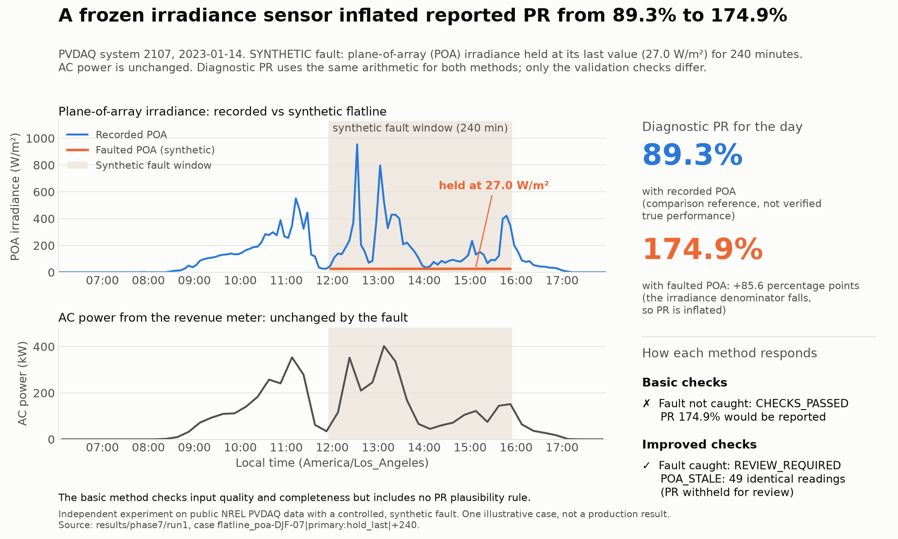

# Solar PR validation: catching faulty sensor data before it reaches a performance report

**An independent experiment on public NREL PVDAQ data, using one site and synthetic, controlled faults.** It is not affiliated with Clir Renewables, uses no Clir data, and makes no claim about Clir's methods or about production reliability.

## The reporting problem

Performance Ratio (PR) compares the energy produced with what the measured sunlight and installed capacity imply under reference conditions.
- If the plane-of-array (POA) irradiance sensor **freezes, drops readings or runs on the wrong clock**, the denominator changes even though actual power output stays the same.
- An analyst preparing a solar performance report has to decide, day by day, whether to **report** PR, **send it to review**, or **withhold** it.
- This project tests whether automated checks can make that decision more reliably.



*One illustrative synthetic case.*
- *The POA reading was frozen at 27 W/m² for 240 minutes and AC power was unchanged. Diagnostic PR moved from 89.3% to 174.9% (+85.6 percentage points).*
- *The basic checks passed it. The improved checks flagged 49 identical readings (`POA_STALE`) and withheld it for review.*
- *The basic method checks input quality and completeness but includes no PR plausibility rule.*
- *The example demonstrates stale-sensor detection. It does not establish that every competent reporting workflow would publish 174.9%.*

*Vector version: [SVG](presentation/figure_flatline_example.svg).*

## Main results (frozen evaluation run1, primary scenarios)

> **The improved checks caught the tested long irradiance flatlines and additional one-hour gaps. Timing uncertainty still allowed some shifted cases with PR changes up to 5.4 percentage points to be reported.**

| Tested fault | Basic | Improved |
|---|---|---|
| Irradiance flatline, 30–240 min | 0/112 | **112/112** |
| Irradiance flatline, 15 min | 0/28 | 0/28 |
| Missing daytime POA, 30 min | 0/26 | 0/26 |
| Missing daytime POA, 60 min | 8/26 | **15/26** |
| Missing daytime POA, 120 and 240 min | 52/52 | 52/52 |
| POA timestamp shift, ±15/30/60 min | 0/168 recognised | 29/168 recognised, **113 inconclusive and still reported** |

**Reading the table:**
- A **case** is one fault scenario and severity applied to one **window** (a sampled unique day). Counts are detected cases / cases whose unmodified window passed. Inconclusive cases stay in the denominator.
- Severities on the same window are correlated: for example, 112/112 = **28 windows × 4 severities**, not 112 independent days.
- **Outcome categories:**
  - *Detected* means the fault-specific check withheld the case.
  - *Inconclusive* means the timing check could not decide, so the case was **still reported**.
  - *Missed* means the case was reported with every check passing.
  - *Withheld through other reasons* means a non-specific rule (such as zero output) withheld it.
- Full detail: [compact table](presentation/results_table.md) and [evaluation results](docs/evaluation_results.md) (severity, season and secondary scenarios).

**In short:**
- The improved checks caught every tested irradiance flatline lasting 30 minutes or longer, and caught 7 more of the 60-minute data gaps.
- The timing check was inconclusive for **113 of 168 shifted cases**. Those cases were still reported, with PR changes of up to 5.4 percentage points. No shifted case was scored *missed*, but that does not mean every shift was detected.
- Across **1,270 unique eligible days** (unmodified), both methods withheld the same **13.9%**. These are unconfirmed alerts, mostly from zero-output readings. The improved checks added no alerts in this population; this should not be generalised to other sites.

## Practical limitations

- **One site, public data, synthetic faults.**
  - The 96 evaluation windows (unique days) are eligible public-data days, not verified fault-free days.
  - The evaluation period was profiled structurally before evaluation, so it is not unseen data.
- **Short faults are invisible to both methods:** 15-minute flatlines and 30-minute gaps.
- **The timing check rarely applies.** It needs a clear-sky day and reached a verdict in 2% (winter) to 42% (autumn) of shift cases.
- **`CHECKS_PASSED` means the configured checks passed. It does not mean the PR is correct.**
  - The basic method checks input quality and completeness. It checks neither timing nor stale values, and neither method has a PR plausibility rule.
  - The improved method marks passed days with inconclusive timing as "timing not verified".
- **The unmodified PR is a comparison reference,** not verified true performance.
- **Next validation step:** labelled real incidents from more sites, and any revised timing rule tested on fresh holdout data. A PR plausibility safeguard is a possible future addition. It would need its own design and validation; it is not implemented here and no universal ceiling is assumed.

Executive summary: [short memo](presentation/executive_memo.md). Presenting it: [three-minute walkthrough](presentation/walkthrough.md). Every headline number is traced in the [claim register](results/phase8/claim_register.csv).

---

## How the experiment was built

**Dataset and site.**
- PVDAQ system 2107 (Arbuckle, CA): 893 kW DC, fixed 25° tilt, a revenue-grade AC meter (15-min) and one POA sensor (5-min).
- Source: NREL PVDAQ via OEDI, [DOI 10.25984/1846021](https://doi.org/10.25984/1846021), CC BY 4.0.
- Site audit: [data card](docs/data_card.md) and [issue register](docs/issue_register.csv).

**Data preparation and lineage** ([data dictionary](docs/data_dictionary.md), [timestamp policy](docs/timestamp_policy.md), [source precedence](docs/source_precedence.md)). Its purpose is to prevent unsupported calculations and to keep every reported figure traceable.
- Every standardized value links to its source file, row and SHA-256.
- Missing, null, zero, invalid, duplicate and time-ambiguous readings are kept as separate states.
- Time is held in UTC. Timezone and daylight-saving ambiguity is flagged rather than guessed.
- PR is computed only over correctly paired power and irradiance intervals.

**PR definition** ([metric definition](docs/metric_definition.md)):
- PR = (E_AC / 893 kW) / (H_POA / 1 kW/m²), not temperature-corrected.
- Computed over a solar-geometry daylight window (sun > 5°), using only 15-minute intervals where power and all three 5-minute POA readings are usable. Nothing is interpolated.
- The arithmetic was verified against hand-worked and independently recomputed days.

**Basic and improved checks** ([check definitions](docs/check_definitions.md)):
- **Basic:** time coverage, range, duplicates and timestamps, sampling regularity, and a zero-output policy.
- **Improved:** all basic checks plus midday-weighted completeness, POA stale-value detection (≥ 6 identical readings) and a clear-sky timing-consistency check.
- Both methods share identical PR arithmetic and pairing.

**Development and evaluation periods:**
- Thresholds were chosen on 2018-02-01 to 2020-01-31.
- Evaluation used 96 windows from 2020-02-01 to 2023-10-31, drawn with a fixed seed and stratified by season ([experiment protocol](docs/experiment_protocol.md)).

**Fault design:**
- **Primary scenarios:** POA rows removed for 30–240 min; POA-only timestamp shifts of ±15/30/60 min; hold-last POA flatlines of 15–240 min.
- **Secondary scenarios** (reported separately): explicit nulls, whole-file shifts, a fixed 600 W/m² flatline.
- **Scale:** 672 cases in total. The detector never sees injection labels.

**Freezes and amendments:**
- **Specification freeze A:** `experiment-v1`, commit `2952d87`.
- **Amendments:** `experiment-v2` (clarified scoring and definitions) and `experiment-v3` (settled injection ambiguities), both made before any evaluation case existed ([amendments](docs/amendments.md)).
- **Implementation freeze B:** commit `42b5fd5`, hashing 36 files, 5 data tables and package versions.
- **Evaluation run1:** exit 0, 672/672 cases on 96 windows; population analysis on 1,270 unique eligible days. Its scoring was re-derived by an independent AI-assisted audit script (26/26 checks); no human review was performed ([evaluation results](docs/evaluation_results.md), [decision log](docs/decision_log.md)).

## Reproduce

```bash
python -m venv .venv
.venv/Scripts/python -m pip install -r requirements.txt
.venv/Scripts/python src/fetch_oedi.py get <keys listed in docs/source_manifest.json>
.venv/Scripts/python src/build_manifest.py
.venv/Scripts/python src/ingest.py
.venv/Scripts/python src/validate_structure.py
.venv/Scripts/python src/run_phase3.py
.venv/Scripts/python src/validate_phase3.py
.venv/Scripts/python src/phase4_development_analysis.py
.venv/Scripts/python src/validate_spec_phase4.py
.venv/Scripts/python src/run_phase5.py
.venv/Scripts/python src/validate_phase5.py
.venv/Scripts/python src/run_evaluation.py verify-freeze
.venv/Scripts/python -m pytest -q tests
.venv/Scripts/python src/audit_phase7.py
.venv/Scripts/python src/analyze_phase7.py
.venv/Scripts/python src/phase8_claims.py
python src/phase8_figure.py
.venv/Scripts/python src/validate_phase8.py
```

- **Raw data** (~517 MB) and the processed Parquet tables are not committed. Re-download them, then check them against the SHA-256 hashes in [docs/source_manifest.json](docs/source_manifest.json).
- **The frozen evaluation** is `src/run_evaluation.py evaluate --run-id <new id>`. It refuses to overwrite an existing run ([runbook](docs/evaluation_runbook.md)).
- **The figure script** runs on system Python with matplotlib so that the frozen project environment stays unchanged.

## Repository structure

| Path | Contents |
|---|---|
| `presentation/` | figure (PNG/SVG), compact results table, executive memo, walkthrough |
| `docs/` | data card, data dictionary, timestamp and precedence policies, metric definition, protocol, amendments, check definitions, runbook, evaluation results, decision log, issue register, revision log |
| `config/` | data-structure, metric and experiment configs (v1, v2, v3) |
| `src/` | ingestion, pairing and metrics, detectors, injector, evaluator, runner, freeze tools, audits, Phase 8 packaging |
| `tests/` | 117 unit, synthetic and full-path tests |
| `results/phase1`–`phase8/` | validation manifests, summaries, evaluation run1 outputs, analysis, claim register |

## Project phases

| Phase | Output |
|---|---|
| 1. Site search and audit | [data card](docs/data_card.md) |
| 2. Raw-to-standardized data layer | [data dictionary](docs/data_dictionary.md) |
| 3. PR definition and arithmetic validation | [metric definition](docs/metric_definition.md) |
| 4. Experiment design, freeze A | [experiment protocol](docs/experiment_protocol.md) (`2952d87`) |
| 5. Basic and improved detectors | [check definitions](docs/check_definitions.md) (`f1ff436`) |
| 6. Injector, evaluator, freeze B | [runbook](docs/evaluation_runbook.md) (`42b5fd5`) |
| 7. Frozen evaluation run1 | [evaluation results](docs/evaluation_results.md) (`cabe1fe`) |
| 8. Presentation package | [memo](presentation/executive_memo.md), [walkthrough](presentation/walkthrough.md), [claim register](results/phase8/claim_register.csv) |

